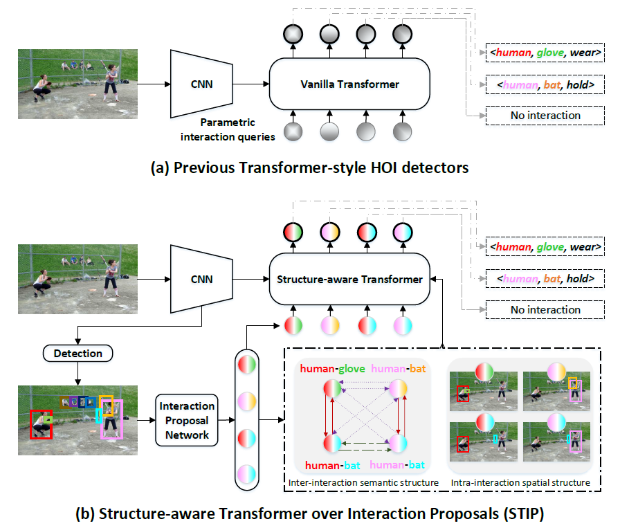

# VCSGHOI

Current project snapshot with the box/ROI-based HOI implementation. Model weights, checkpoints, bulk experiment outputs, and local caches are not included. The original project documentation and attribution are retained below.

## [CVPR 2022] Exploring Structure-aware Transformer over Interaction Proposals for Human-object Interaction Detection

* [PDF](https://openaccess.thecvf.com/content/CVPR2022/papers/Zhang_Exploring_Structure-Aware_Transformer_Over_Interaction_Proposals_for_Human-Object_Interaction_Detection_CVPR_2022_paper.pdf)
* [Supplementary](https://openaccess.thecvf.com/content/CVPR2022/supplemental/Zhang_Exploring_Structure-Aware_Transformer_CVPR_2022_supplemental.pdf)

## Paper introduction

Recent high-performing Human-Object Interaction (HOI) detection techniques have been highly influenced by Transformer-based object detector (i.e., DETR). Nevertheless, most of them directly map parametric interaction queries into a set of HOI predictions through vanilla Transformer in a one-stage manner. This leaves rich inter- or intra-interaction structure under-exploited. In this work, we design a novel Transformer-style HOI detector, i.e., Structure-aware Transformer over Interaction Proposals (STIP), for HOI detection. Such design decomposes the process of HOI set prediction into two subsequent phases, i.e., an interaction proposal generation is first performed, and then followed by transforming the non-parametric interaction proposals into HOI predictions via a structure-aware Transformer. The structure-aware Transformer upgrades vanilla Transformer by encoding additionally the holistically semantic structure among interaction proposals as well as the locally spatial structure of human/object within each interaction proposal, so as to strengthen HOI predictions. Extensive experiments conducted on V-COCO and HICO-DET benchmarks have demonstrated the effectiveness of STIP, and superior results are reported when comparing with the state-of-the-art HOI detectors.

<p align="center"></p>

## Installation

### 1. Environmental Setup
```bash
$ conda create -n STIP python=3.7
$ conda install -c pytorch pytorch torchvision # PyTorch 1.7.1, torchvision 0.8.2, CUDA=11.0
$ conda install cython scipy
$ pip install pycocotools
$ pip install opencv-python
$ pip install wandb
```

### 2. HOI dataset setup
Our current version supports the experiments for both [V-COCO](https://github.com/s-gupta/v-coco) and [HICO-DET](https://drive.google.com/file/d/1QZcJmGVlF9f4h-XLWe9Gkmnmj2z1gSnk/view) dataset.
Download the dataset under the pulled directory.
For HICO-DET, we use the [annotation files](https://drive.google.com/file/d/1QZcJmGVlF9f4h-XLWe9Gkmnmj2z1gSnk/view) provided by the PPDM authors.
Download the [list of actions](https://drive.google.com/open?id=1EeHNHuYyJI-qqDk_-5nay7Mb07tzZLsl) as `list_action.txt` and place them under the unballed hico-det directory.
Below we present how you should place the files.
```bash
# V-COCO setup
$ git clone https://github.com/s-gupta/v-coco.git
$ cd v-coco
$ ln -s [:COCO_DIR] coco/images # COCO_DIR contains images of train2014 & val2014
$ python script_pick_annotations.py [:COCO_DIR]/annotations

# HICO-DET setup
$ tar -zxvf hico_20160224_det.tar.gz # move the unballed folder under the pulled repository

# dataset setup
STIP
 │─ v-coco
 │   │─ data
 │   │   │─ instances_vcoco_all_2014.json
 │   │   :
 │   └─ coco
 │       │─ images
 │       │   │─ train2014
 │       │   │   │─ COCO_train2014_000000000009.jpg
 │       │   │   :
 │       │   └─ val2014
 │       │       │─ COCO_val2014_000000000042.jpg
 :       :       :
 │─ hico_20160224_det
 │       │─ list_action.txt
 │       │─ annotations
 │       │   │─ trainval_hico.json
 │       │   │─ test_hico.json
 │       │   └─ corre_hico.npy
 :       :
```

If you wish to download the datasets on our own directory, simply change the 'data_path' argument to the directory you have downloaded the datasets.
```bash
--data_path [:your_own_directory]/[v-coco/hico_20160224_det]
```

### 3. Training/Testing on V-COCO

```shell
python STIP_main.py --validate \
    --num_hoi_queries 32 --batch_size 4 --lr 5e-5 --HOIDet --hoi_aux_loss --no_aux_loss \
    --dataset_file vcoco  --data_path v-coco --detr_weights https://dl.fbaipublicfiles.com/detr/detr-r50-e632da11.pth \
    --output_dir checkpoints/vcoco --group_name STIP_debug --run_name vcoco_run1
```

* Add `--eval` option for evaluation

### 4. Training/Testing on HICO-DET

Training with pretrained DETR detector on COCO.
```shell
python STIP_main.py --validate \
    --num_hoi_queries 32 --batch_size 4 --lr 5e-5 --HOIDet --hoi_aux_loss --no_aux_loss \
    --dataset_file hico-det --data_path hico_20160224_det --detr_weights https://dl.fbaipublicfiles.com/detr/detr-r50-e632da11.pth \
    --output_dir checkpoints/hico-det --group_name STIP_debug --run_name hicodet_run1
```

Jointly fine-tune object detector & HOI detector
```shell
python STIP_main.py --validate \
    --num_hoi_queries 32 --batch_size 2 --lr 1e-5 --HOIDet --hoi_aux_loss \
    --dataset_file hico-det --data_path hico_20160224_det \
    --output_dir checkpoints/hico-det --group_name STIP_debug --run_name hicodet_run1/jointly-tune \
    --resume checkpoints/hico-det/STIP_debug/best.pth --train_detr
```

## HOI-Oriented Visual Scene Graph Reasoner

### First-Version Design

This version keeps the original human-object proposal network unchanged. After top-k human-object proposals are selected, we construct a visual scene graph over detected humans and objects.

Nodes:

- Human nodes and object nodes come from DETR detections.
- Node features are built from DETR query features and BLIP ROI features in the current implementation. The first-version design also reserves class embedding, box encoding, and node type embedding for richer node fusion.

Edges:

- `E_ho`: proposal-driven human-object edges. These are initialized by the original top-k proposal pairs and proposal scores.
- `E_oo`: spatial object-object context edges. Each object connects to its nearest `graph_k_oo` object neighbors by normalized box center distance.
- `E_hh`: reserved for future use, disabled by default.

Graph reasoning:

- An edge-aware graph transformer updates both node states and edge states.
- Human-object edge states are the main interaction representation.
- The refined human-object edge feature is added to the original decoder query through a zero-initialized learnable residual gate.

Decoder:

- The original interaction decoder is kept unchanged.
- The graph output has the same `d_model` dimension as the decoder query.
- Final verb / HOI classification still uses the original heads and losses.

Current version does not include:

- Text graph alignment.
- Graph contrastive loss.
- No-interaction edge head.
- Additional supervision.

### Configuration

The visual scene graph is disabled by default. Relevant flags:

```bash
--use_visual_scene_graph          # default: False
--graph_num_layers 2              # default: 2
--graph_num_heads 8               # default: 8
--graph_k_oo 3                    # default: 3
--graph_enable_oo_edges           # default: True
--no_graph_oo_edges               # set graph_enable_oo_edges=False
--graph_enable_hh_edges           # default: False
--graph_dropout 0.1               # default: 0.1
--graph_debug                     # default: False
```

Ablation examples:

- A0: baseline, do not pass `--use_visual_scene_graph`.
- A1: `--use_visual_scene_graph --no_graph_oo_edges`, only `E_ho`.
- A2: `--use_visual_scene_graph --graph_k_oo 3`, `E_ho + E_oo` with top-3 object neighbors.
- A3: `--use_visual_scene_graph --graph_k_oo 5`, checks the effect of more object-object edges.
- A4: `--use_visual_scene_graph --graph_enable_hh_edges`, optional future human-human context.

Text graph ablation examples:

Pure visual graph baseline:

```bash
--use_visual_scene_graph \
--graph_enable_text_graph False
```

Visual graph + text graph cross attention, with zero-initialized gate:

```bash
--use_visual_scene_graph \
--graph_enable_text_graph \
--graph_text_features_path data/hico_text_graph/hico_hoi_graph_blip256_text_features_6x256.npy \
--graph_text_mask_path data/hico_text_graph/hico_hoi_graph_blip256_text_mask_6.npy \
--graph_text_hoi_ids_path data/hico_text_graph/hico_hoi_graph_blip256_hoi_ids.json \
--graph_text_object_to_hoi_indices_path data/hico_text_graph/hico_hoi_graph_blip256_object_to_hoi_indices.json \
--graph_text_field_order_path data/hico_text_graph/hico_hoi_graph_blip256_field_order.json \
--graph_text_topk 5 \
--graph_text_pre_topk 20 \
--graph_text_query_source refined_edge \
--graph_text_gate_init 0.0
```

Enable text-hybrid OO prior:

```bash
--graph_oo_mode text_hybrid \
--graph_oo_prior_path data/hico_text_graph/hico_hoi_conditioned_text_graph_gpt55_oo_affordance_prior.npy \
--graph_oo_lambda_text 0.5
```

Enable direct HO-edge text prior injection:

```bash
--graph_text_prior_injection edge_only \
--graph_text_use_ho_edge_prior \
--graph_text_edge_prior_gate_init 0.0
```

Full stable text graph configuration:

```bash
--use_visual_scene_graph \
--graph_oo_mode text_hybrid \
--graph_oo_prior_path data/hico_text_graph/hico_hoi_conditioned_text_graph_gpt55_oo_affordance_prior.npy \
--graph_oo_lambda_text 0.5 \
--graph_enable_text_graph \
--graph_text_features_path data/hico_text_graph/hico_hoi_graph_blip256_text_features_6x256.npy \
--graph_text_mask_path data/hico_text_graph/hico_hoi_graph_blip256_text_mask_6.npy \
--graph_text_hoi_ids_path data/hico_text_graph/hico_hoi_graph_blip256_hoi_ids.json \
--graph_text_object_to_hoi_indices_path data/hico_text_graph/hico_hoi_graph_blip256_object_to_hoi_indices.json \
--graph_text_field_order_path data/hico_text_graph/hico_hoi_graph_blip256_field_order.json \
--graph_text_topk 5 \
--graph_text_pre_topk 20 \
--graph_text_use_discriminative_rerank \
--graph_text_query_source refined_edge \
--graph_text_gate_init 0.0 \
--graph_text_prior_injection none
```

### Implementation Notes

Main files:

- `src/models/stip.py`: collects DETR, BLIP, proposal, node, and edge inputs; calls the graph reasoner when `use_visual_scene_graph=True`; applies the zero-gated residual to the decoder query.
- `src/models/visual_scene_graph.py`: builds `E_ho`, `E_oo`, optional `E_hh`, geometry features, dense edge tensors, and the edge-aware graph transformer.

Current feature flow:

- DETR boxes are converted from normalized `cxcywh` to normalized `xyxy` before graph and BLIP ROI use.
- BLIP patch tokens remove the CLS token before ROI pooling.
- Human/object node BLIP features use ROIAlign on the full-image BLIP patch grid.
- Union edge BLIP features use the earlier region-image masking/cropping style and are sent through BLIP image encoding.
- The original proposal pair feature `sampled_rel_reps` is still used as the proposal/edge feature source before graph reasoning.

### Current Data Flow

1. Input image batch enters `STIP.forward` in `src/models/stip.py`.

2. DETR backbone and transformer produce object-query features and boxes:

```text
features, pos = self.detr.backbone(samples)
hs, detr_encoder_outs = self.detr.transformer(...)
inst_repr = hs[-1]                         # [B, num_queries, 256]
outputs_class = self.detr.class_embed(hs)
outputs_coord = self.detr.bbox_embed(hs)   # normalized cxcywh
```

3. The original proposal network is kept unchanged. For each image, the code builds candidate human-object pairs and scores them:

```text
rel_mat -> rel_pairs
all_rel_reps = self.coarse_relation_feature_extractor(...)
p_relation_exist_logits = self.relation_proposal_mlp(all_rel_reps)
sampled_rel_inds -> sampled_rel_pairs
sampled_rel_reps = all_rel_reps[sampled_rel_inds]
sampled_rel_pred_exists = p_relation_exist_logits[sampled_rel_inds]
```

Key shapes:

```text
sampled_rel_pairs       # [K, 2], DETR query indices [human_idx, object_idx]
sampled_rel_reps        # [K, 1024], original proposal/pair feature
sampled_rel_pred_exists # [K], original proposal score/logit
```

4. BLIP runs once on the full image to produce the last-layer tokens:

```text
blip_last_layer = self.blip(..., match_head='last_layer')  # [1, 577, 256]
blip_action = blip_last_layer[:, 0, :]                     # [1, 256]
blip_patches = blip_last_layer[:, 1:, :]                   # [1, 576, 256]
```

5. Node-level graph inputs are collected in the original DETR query index space:

```text
pred_boxes_xyxy_img = box_cxcywh_to_xyxy(outputs_coord[-1, imgid]).clamp(0, 1)  # [N, 4]
node_detr_features = inst_repr[imgid]                                           # [N, 256]
node_blip_roi_features = ROIAlign(blip_patches, pred_boxes_xyxy_img)            # [N, 256]
node_classes = inst_labels                                                       # [N]
node_types = 0 for human, 1 for object                                           # [N]
node_mask = valid non-background node mask                                       # [N]
```

6. Proposal edge inputs are collected after top-k proposal selection:

```text
proposal_human_boxes = pred_boxes_xyxy_img[sampled_rel_pairs[:, 0]]   # [K, 4]
proposal_object_boxes = pred_boxes_xyxy_img[sampled_rel_pairs[:, 1]]  # [K, 4]
proposal_union_boxes = union(human_box, object_box)                   # [K, 4]
proposal_pair_features = sampled_rel_reps                             # [K, 1024]
proposal_scores = sampled_rel_pred_exists                             # [K]
proposal_human_blip_features = node_blip_roi_features[human_idx]      # [K, 256]
proposal_object_blip_features = node_blip_roi_features[object_idx]    # [K, 256]
proposal_union_blip_features = BLIP(masked union region image)        # [K, 256]
```

7. The original decoder query is still constructed first:

```text
query_reps = self.rel_query_pre_proj(sampled_rel_reps).unsqueeze(1)  # [K, 1, 256]
```

8. If `--use_visual_scene_graph` is disabled, `query_reps` goes directly to the original interaction decoder.

9. If `--use_visual_scene_graph` is enabled, `src/models/visual_scene_graph.py` receives graph inputs:

```text
node_feats = node_detr_features + node_blip_roi_features    # [1, N, 256]
boxes = pred_boxes_xyxy_img                                 # [1, N, 4]
labels = inst_labels                                        # [1, N]
node_types = node_types                                     # [1, N]
node_mask = node_mask                                       # [1, N]
pair_indices = sampled_rel_pairs                            # [1, K, 2]
pair_scores = sampled_rel_pred_exists                       # [1, K]
pair_feats = query_reps.squeeze(1)                          # [1, K, 256]
union_feats = proposal_union_blip_features                  # [1, K, 256]
global_feat = blip_action                                   # [1, 256]
```

10. The graph reasoner builds dense edge tensors:

```text
E_ho: human <-> object proposal edges from sampled_rel_pairs
E_oo: object <-> object spatial top-k edges
edge_attr_dense  # [1, N, N, 256]
edge_mask_dense  # [1, N, N]
```

11. The edge-aware graph transformer updates node and edge states, then reads back the updated human-object edge states:

```text
graph_pair_feats = graph_out.pair_feats.squeeze(0)  # [K, 256]
```

12. The graph branch is added to the original decoder query through the zero-initialized residual gate:

```text
query_reps = query_reps + tanh(graph_gate) * graph_pair_feats.unsqueeze(1)
```

Because `graph_gate` starts at 0, the initial behavior is equivalent to the baseline even when the graph branch is enabled.

13. The original interaction decoder, classification heads, losses, matcher, and evaluator are unchanged:

```text
outs = self.interaction_decoder(tgt=query_reps, ...)
action_logits = self.action_embed(outs)
```

### How to Review the Graph Changes

Recommended review order:

1. `src/models/stip.py`

- Check `__init__` for `self.use_visual_scene_graph`, `self.visual_scene_graph`, and `self.graph_gate`.
- Check that BLIP is still frozen and SAM is not imported or initialized.
- Check that proposal generation still happens before graph construction.
- Check that `sampled_rel_pairs`, `sampled_rel_reps`, and `sampled_rel_pred_exists` are not changed before proposal loss and decoder query construction.
- Check the `graph_input` dictionary fields and shapes.
- Check the gated residual add into `query_reps`.

2. `src/models/visual_scene_graph.py`

- Check `VisualSceneGraphReasoner.forward` input shapes.
- Check `E_ho` construction from `pair_indices` and `pair_scores`.
- Check `E_oo` spatial top-k construction and `node_mask` filtering.
- Check `EdgeAwareGraphLayer` attention mask and self-loop logic.
- Check pair feature readback from updated human-object edge states.

3. `src/lm/BLIP/build_blip.py` and `src/lm/BLIP/vit.py`

- Check `match_head='last_layer'`.
- Check that `return_last_only=True` avoids collecting all three last layers for the current path.

4. `STIP_main.py` and `src/engine/arg_parser.py`

- Check graph ablation flags and defaults.

Quick checks:

```bash
/share/apps/anaconda3/envs/SPLHOI/bin/python -m py_compile \
  src/models/stip.py \
  src/models/visual_scene_graph.py \
  src/lm/BLIP/build_blip.py \
  src/lm/BLIP/vit.py \
  src/engine/arg_parser.py \
  STIP_main.py
```

Use `--graph_debug` for the first run to print one-time graph sanity information:

```text
valid_nodes, E_ho edge count, E_oo edge count, graph_pair_feats mean/std, graph_gate
```

### High-Risk Checks

1. Box coordinate format

- DETR commonly outputs normalized `cxcywh`.
- ROIAlign and graph geometry use `xyxy`.
- Always convert with `box_ops.box_cxcywh_to_xyxy(...).clamp(0, 1)` before graph construction.
- Do not mix `cxcywh` and `xyxy` in graph geometry or ROI pooling.

2. Pair index coordinate system

- The current implementation keeps graph nodes in the original DETR query index space, so `sampled_rel_pairs[:, 0/1]` can be used directly for `node_feats`, `node_boxes`, and dense edge lookup.
- If a future version compacts graph nodes into `humans first + objects second`, then object indices must be remapped with a `+ Nh` offset.
- This is one of the easiest places to introduce silent wrong edges.

3. BLIP patch token reshape

- BLIP output includes a CLS token. Remove CLS before ROI pooling: `blip_patches = blip_last_layer[:, 1:, :]`.
- Patch token count must form the expected patch grid. Current 384x384 BLIP input with patch size 16 gives `24 x 24 = 576` tokens.
- If BLIP input becomes non-square, do not use `sqrt(token_count)` blindly. Use the real patch grid size from the BLIP visual encoder.

4. ROIAlign coordinate scale

- If boxes are normalized `xyxy`, multiply by the BLIP feature map width and height, not the original image width and height.
- Only use original image dimensions if `spatial_scale` and feature coordinates are set consistently.
- Current BLIP patch ROI pooling scales boxes by the patch grid size.

5. Edge mask and padding

- Attention must not leave a node with all logits equal to `-inf`.
- The graph layer adds self-loops for valid nodes to avoid all-masked attention rows.
- Padding nodes must not participate in message passing, edge construction, or pair output.

6. Graph gate

- `graph_gate` is initialized to 0 for stability.
- The residual branch is `decoder_query + tanh(graph_gate) * graph_pair_feats`.
- With the initial gate value, the graph branch does not change the baseline decoder query.
- If training is too slow to use the graph branch, a future experiment may initialize the gate to a small non-zero value such as 0.1, but the first version uses 0.

7. Decoder input dimension

- Do not concatenate graph features into the decoder query and change the decoder input dimension.
- The first version uses residual addition with the same `d_model`, which is the safest integration path.

## Citation

If you find this code helpful for your research, please cite our paper.
```
@InProceedings{Zhang_2022_CVPR,
    author    = {Zhang, Yong and Pan, Yingwei and Yao, Ting and Huang, Rui and Mei, Tao and Chen, Chang-Wen},
    title     = {Exploring Structure-Aware Transformer Over Interaction Proposals for Human-Object Interaction Detection},
    booktitle = {Proceedings of the IEEE/CVF Conference on Computer Vision and Pattern Recognition (CVPR)},
    month     = {June},
    year      = {2022},
    pages     = {19548-19557}
}
```

## Others

Credit: [DETR](https://github.com/facebookresearch/detr), [HOTR](https://github.com/kakaobrain/HOTR)
# OSSM-HOI
# OSSM-HOI
